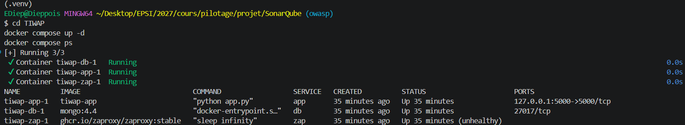
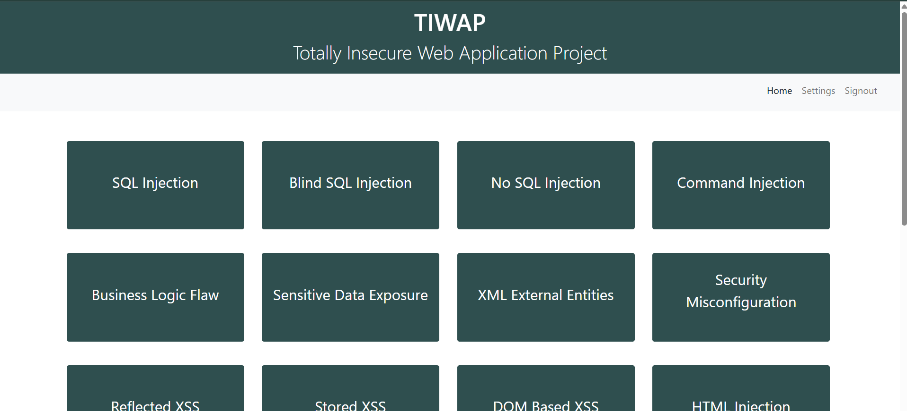
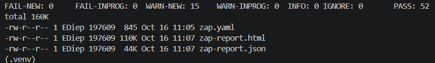
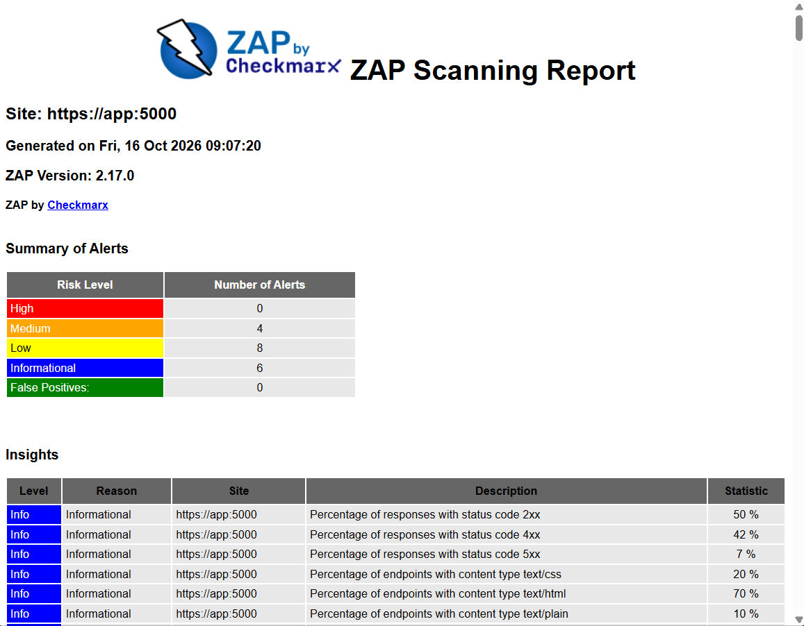
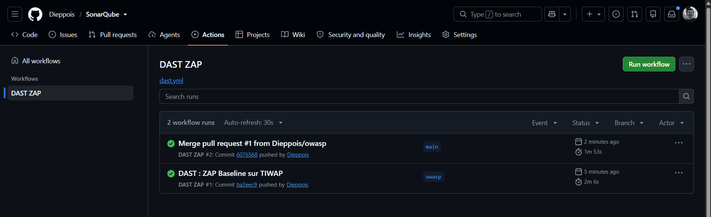
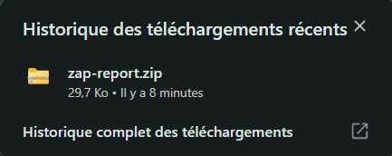

# TP : Analyse dynamique (DAST) de TIWAP avec OWASP ZAP

Entreprise : NOVA SERVICES | Application étudiée : TIWAP
Auteur : Edouard Dieppois | Date : 16/10/2026

## 1. Déploiement

Fichier modifié : [TIWAP/docker-compose.yml](TIWAP/docker-compose.yml)

- `app` : port limité à `127.0.0.1:5000`.
- `db` : port MongoDB retiré.
- `zap` : service ajouté, rapports récupérés dans `reports/`.

TIWAP répond en HTTPS (certificat auto-signé) : la cible est donc `https://app:5000`.



Le port web n'est publié que sur `127.0.0.1` et MongoDB (`27017/tcp`) n'est pas publié sur l'hôte.



## 2. Scan de référence

```bash
docker compose exec zap zap-baseline.py -t https://app:5000 -m 2 -r zap-report.html -J zap-report.json
```




Rapports : [zap-report.html](rapports-zap/zap-report.html) et [zap-report.json](rapports-zap/zap-report.json)

Résultat : 15 alertes WARN, 0 FAIL (0 High, 4 Medium, 8 Low, 6 Informational).

## 3. Qualification des alertes

| Alerte constatée | Risque indiqué | Vérification nécessaire | Action envisagée |
|---|---|---|---|
| Source Code Disclosure - SQL (10099) et Application Error Disclosure (90022) sur `POST /login` | Medium et Low | Comprendre pourquoi `/login` renvoie une erreur 500 et ce qu'elle affiche | Corriger |
| Content Security Policy Header Not Set (10038) | Medium | Confirmer l'absence de l'en-tête et son impact sur une application qui contient des XSS | Corriger |
| Absence of Anti-CSRF Tokens (10202) | Medium (confiance faible) | Seul le formulaire de connexion a été vu, les formulaires derrière l'authentification n'ont pas été explorés | Analyse complémentaire |
| Server Leaks Version Information (10036) | Low | `Server: Werkzeug/2.0.3 Python/3.6.15` : vérifier si la version est obsolète | Corriger |

## 4. Pourquoi une alerte doit être vérifiée

ZAP a soumis le formulaire de connexion avec un utilisateur inexistant. L'application a répondu par une erreur 500 qui affiche la trace Python complète.

En lisant le code :
- `check_login` (`helper/db_manager.py:43-45`) lit `data[1]` alors que `data` vaut `None` quand l'utilisateur n'existe pas ;
- l'application tourne avec `debug=True` (`app.py:913`), d'où l'affichage de la trace et du **débogueur interactif Werkzeug**.

ZAP classe ces alertes Medium et Low. En contexte, elles sont **critiques** :
- n'importe quel visiteur peut déclencher l'erreur ;
- la trace révèle le code et les chemins internes ;
- la console du débogueur permet d'exécuter du code sur le serveur si son PIN est obtenu.

À l'inverse, le nom « Source Code Disclosure - SQL » laisse croire à une injection SQL. Or la requête affichée est paramétrée (`?`) : il s'agit d'une fuite de code, pas d'une injection. Le niveau et le nom d'une alerte ne suffisent donc pas : il faut vérifier le contexte.

## 5. Injection SQL

**Le scan n'a détecté aucune injection SQL.** La page `/sql-injection` exige d'être connecté et ZAP ne l'était pas. De plus, le Baseline Scan est passif : il n'envoie aucune charge d'injection.

SonarQube ne l'avait pas détectée non plus (TP précédent). Elle a été confirmée par la lecture du code et des tests. Pour la détecter en DAST, il faudrait un scan authentifié et actif dans un environnement autorisé.

## 6. Fiches de traitement NOVA SERVICES

| Champ | Fiche 1 | Fiche 2 | Fiche 3 |
|---|---|---|---|
| Référence | 10099 + 90022 | 10038 | 10036 |
| Application | TIWAP, cible de laboratoire | TIWAP, cible de laboratoire | TIWAP, cible de laboratoire |
| Actif métier analogue | Portail client (connexion publique) | Portail client et back-office | Applications Flask hébergées |
| Impact | Exécution de code sur le serveur, fuite du code source | Aggrave les XSS (vol de session) | Facilite le ciblage de failles connues (Python 3.6 en fin de vie) |
| Priorité | Critique : sans authentification, impact total | Élevée : l'application contient des XSS | Moyenne : pas exploitable seule |
| Responsable | Équipe de développement | Exploitation | Exploitation |
| Échéance | 23/10/2026 | 15/11/2026 | 15/12/2026 |
| Action | `debug=False`, gérer l'utilisateur inconnu, page d'erreur générique | Ajouter l'en-tête `Content-Security-Policy` | Masquer l'en-tête `Server`, mettre à jour Python |
| Vérification | Connexion avec un utilisateur inconnu, puis nouveau scan | Nouveau scan | Nouveau scan |
| Statut | Ouvert | Ouvert | Ouvert |

## 7. Pipeline GitHub Actions

Fichier : [.github/workflows/dast.yml](.github/workflows/dast.yml)

Étapes du workflow :
1. Démarrer TIWAP et ZAP.
2. Attendre que TIWAP réponde.
3. Lancer le Baseline Scan.
4. Publier les rapports comme artefact.
5. Arrêter les services.

L'option `-I` évite que les alertes WARN fassent échouer le job. Le dossier `reports/` est exclu de Git.




## 8. Indicateurs

| Indicateur | Calcul | Source | Fréquence | Responsable | Décision |
|---|---|---|---|---|---|
| Vulnérabilités confirmées ouvertes | Nombre par priorité | Fiches de traitement | Hebdomadaire | RSSI | Répartir l'effort de correction |
| Vulnérabilités en retard | Critiques ou élevées dont l'échéance est dépassée | Outil de tickets | Hebdomadaire | RSSI | Escalader ou bloquer une mise en production |
| Corrections vérifiées | Corrections confirmées par un nouveau scan / corrections déclarées | Rapports ZAP | Mensuelle | Équipe sécurité | Valider ou rouvrir une correction |
| Couverture DAST | Applications critiques scannées / applications critiques | GitHub Actions | Mensuelle | Responsable sécurité applicative | Étendre le DAST aux applications non couvertes |

## 9. Questions

**Partie 1**

1. Sinon ZAP n'explore rien, et un rapport vide pourrait passer pour un bon résultat.
2. Seule l'application a besoin de la base. L'exposer, avec des identifiants par défaut, la rendrait accessible depuis le réseau.

**Questions de compréhension**

1. Le SAST lit le code sans l'exécuter. Le DAST interroge l'application en fonctionnement.
2. ZAP n'a pas accès au code : il analyse uniquement les réponses de l'application.
3. Dans le conteneur ZAP, `localhost` désigne ZAP lui-même. `app` est le nom du service sur le réseau Docker.
4. Le scan passif observe les échanges. Le scan actif envoie des attaques, qui peuvent modifier des données.
5. Il n'envoie aucune charge d'injection et n'explore pas les pages qui demandent une authentification.
6. Une alerte est un constat de l'outil. Une vulnérabilité confirmée a été vérifiée dans son contexte.
7. Selon la sensibilité des données, l'exposition, la facilité d'exploitation et l'impact, pas selon le seul niveau donné par ZAP.
8. Pour garder une preuve de chaque contrôle et comparer les scans dans le temps.
9. Publier les ports uniquement sur `127.0.0.1`, ne pas exposer la base et arrêter les conteneurs après usage.
10. Le délai médian de correction, les vulnérabilités en retard et le pourcentage de corrections vérifiées.

## 10. Conclusion

Le DAST a révélé ce que SonarQube ne voyait pas : les en-têtes manquants et surtout le débogueur exposé par une erreur 500. Il a cependant des limites. Sans authentification, il n'a exploré qu'une petite partie de l'application, et en mode passif il n'a pas trouvé l'injection SQL. Le SAST, lui, voit le code (secrets, JWT, MD5), mais pas la configuration en fonctionnement.

Les deux approches sont complémentaires. Leurs résultats doivent être vérifiés avant d'être priorisés, et ne garantissent pas l'absence de failles.
