# TP : Détection et correction d'une injection SQL avec SonarQube

Entreprise : NOVA SERVICES | Application étudiée : TIWAP
Auteur : Edouard Dieppois | Date : 16/10/2026

Aucun secret n'apparaît dans ce rapport : le mot de passe PostgreSQL est dans `.env` (ignoré par Git) et le jeton d'analyse n'est passé que par variable d'environnement.

## 1. Déploiement et architecture

Versions : SonarQube Community Build 26.10, PostgreSQL 17, SonarScanner CLI 8.1.

Le fichier [compose.yaml](compose.yaml) contient trois services reliés par le réseau `sonarnet` :

- `db` : base PostgreSQL de SonarQube, données conservées dans un volume.
- `sonarqube` : interface web, accessible uniquement sur `127.0.0.1:9000`.
- `scanner` : analyse le dossier `TIWAP` monté dans `/usr/src` et contacte `http://sonarqube:9000`. Il ne démarre qu'avec `docker compose run`.

TIWAP n'est jamais lancé, seul son code est analysé.

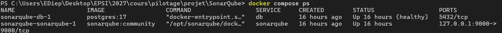
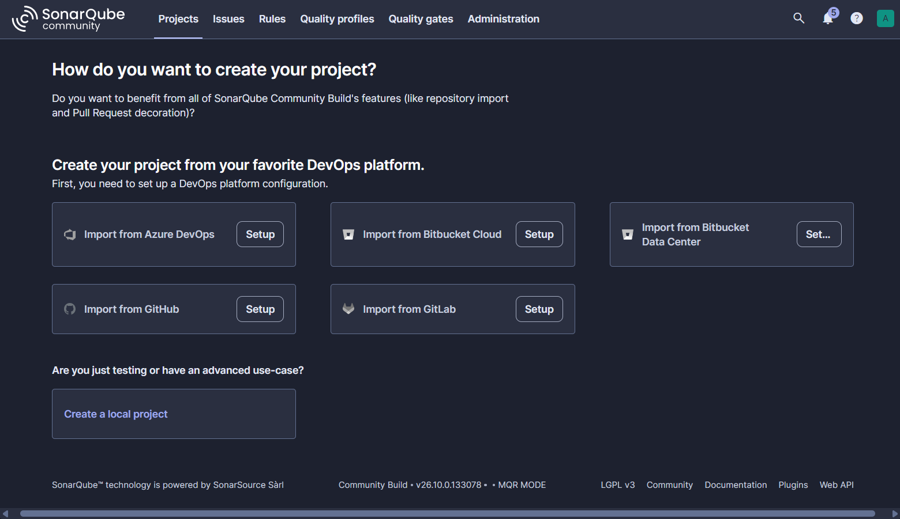

## 2. Configuration de l'analyse

Fichier `TIWAP/sonar-project.properties` :

```properties
sonar.projectKey=tiwap
sonar.projectName=TIWAP
sonar.projectVersion=1.0
sonar.sources=.
sonar.sourceEncoding=UTF-8
```

Lancement : `docker compose run --rm -e SONAR_TOKEN=$env:SONAR_TOKEN scanner`

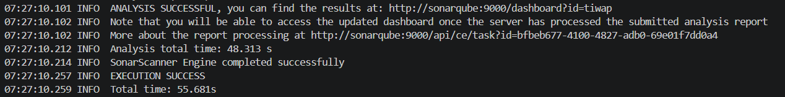

## 3. Analyse initiale

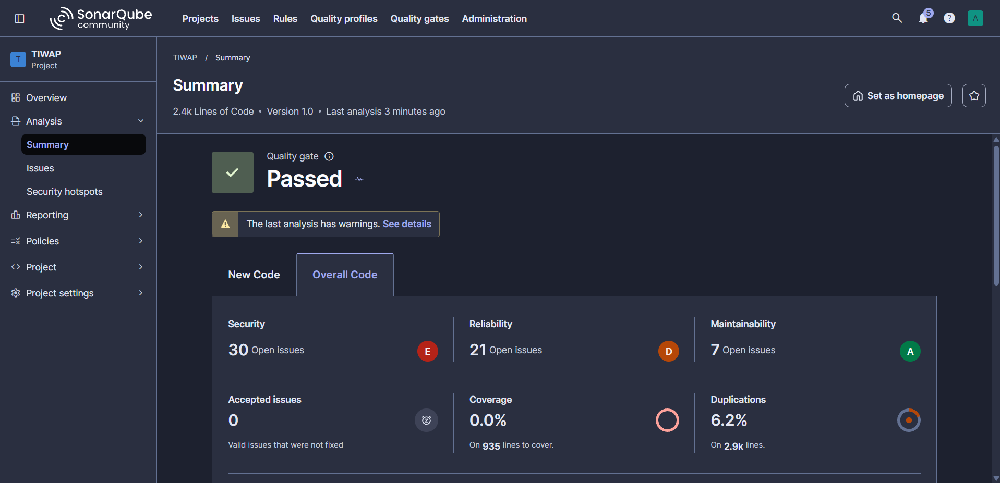

51 issues dont 30 en sécurité (2 Blocker, 16 High). L'onglet Security Hotspots est vide : dans cette version, les anciens hotspots sont affichés comme des issues.

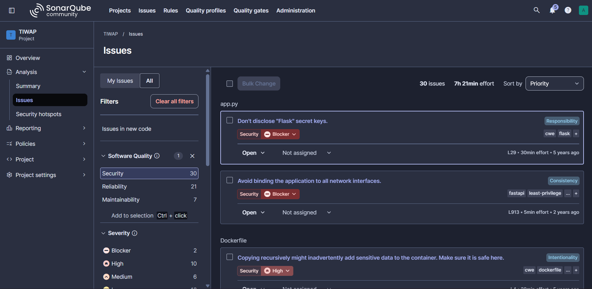

| Identifiant | Fichier et ligne | Règle | Type | Impact potentiel | Confiance | Action |
|---|---|---|---|---|---|---|
| b376d625-8b6a-49d1-9bdd-bae85e7f6300 | app.py:29 | python:S6779 | Vulnérabilité, Blocker | Clé Flask écrite en dur : on peut forger un cookie de session et contourner la connexion | Confirmé | Corriger (clé dans une variable d'environnement) |
| 9e3e5bf7-37b3-44de-bd3b-c782deaa6ea0 | helper/auth.py:39 | python:S5659 | Vulnérabilité, High | Signature du JWT non vérifiée : on peut modifier le jeton et usurper un compte | Confirmé | Corriger (vérifier la signature) |
| 307e9ee7-d983-4442-8df0-aea6493a13fa | helper/db_manager.py:47 | python:S4790 | Ancien hotspot, High | Mots de passe hachés en MD5 sans sel, faciles à retrouver si la base fuit | Confirmé | Corriger (bcrypt ou argon2) |
| Aucun | vulnerabilities/SQLi.py:22 | Aucune | Injection SQL | Connexion sans mot de passe, lecture de la table users | Confirmé par lecture du code | Corriger |

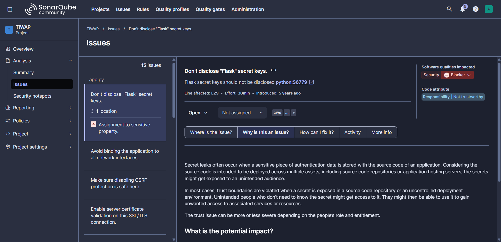
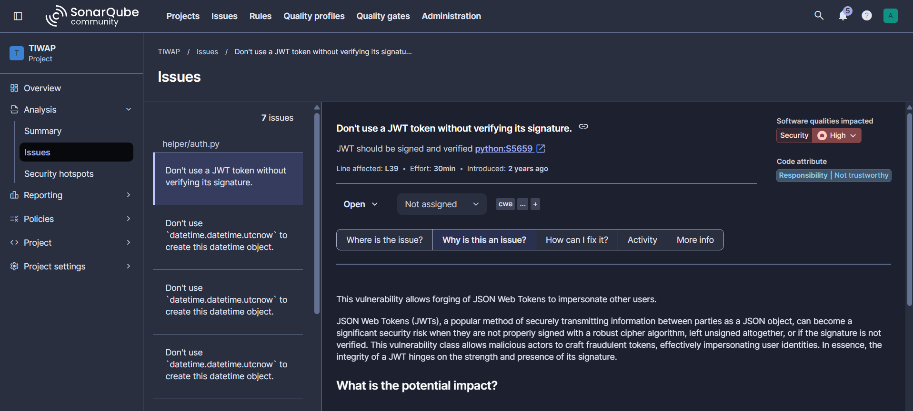
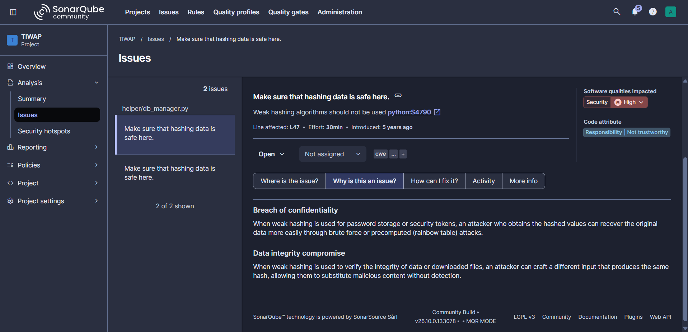

SonarQube ne signale pas l'injection SQL. Sur `SQLi.py`, la seule issue concerne MD5. La règle qui suit les entrées utilisateur (S3649) n'existe pas en édition Community, et la règle S2077 sur les requêtes SQL formatées n'est pas active dans le profil par défaut.

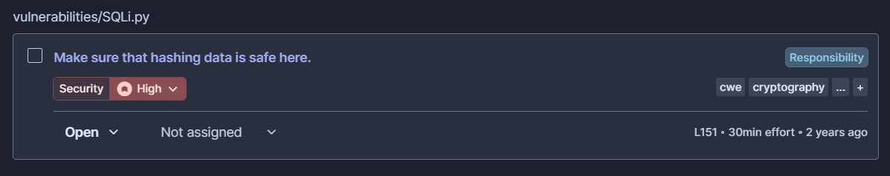

## 4. Examen du code et correction

Recherche des requêtes et des entrées utilisateur :

```powershell
Get-ChildItem TIWAP -Recurse -Include *.py | Select-String -Pattern 'execute\(|SELECT|request\.args|request\.form'
```

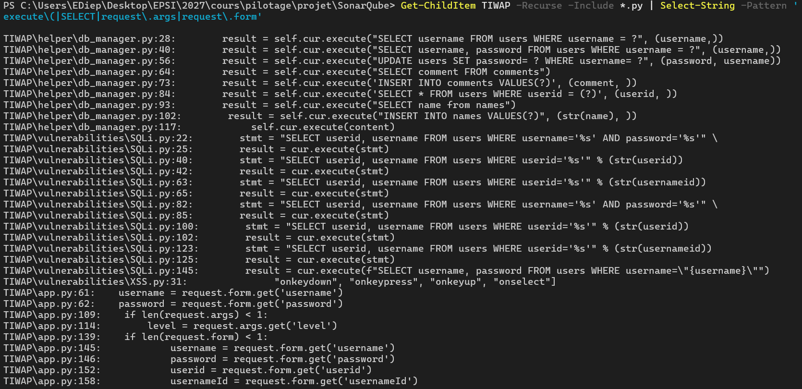

Les requêtes de `helper/db_manager.py` utilisent des paramètres `?` et ne sont pas vulnérables. Celles de `vulnerabilities/SQLi.py` insèrent l'entrée utilisateur dans le texte SQL.

Chemin de la donnée : `request.form.get('username')` dans `app.py:145`, puis `SQLi.sqli_low()`, puis `cur.execute(stmt)`.

Code vulnérable (`SQLi.py:22`) :

```python
stmt = "SELECT userid, username FROM users WHERE username='%s' AND password='%s'" \
       % (str(username), str(password))
result = cur.execute(stmt)
```

Avec `x' OR '1'='1' --` comme nom d'utilisateur, l'apostrophe ferme la chaîne, la condition devient toujours vraie et `--` ignore le mot de passe. La fonction renvoie alors les 5 comptes de la base.

Code corrigé :

```python
stmt = "SELECT userid, username FROM users WHERE username = ? AND password = ?"
result = cur.execute(stmt, (str(username), str(password)))
```

La requête est fixée à l'avance et le pilote `sqlite3` transmet les valeurs séparément. Une apostrophe saisie reste un simple caractère et ne modifie plus la requête. La même correction est appliquée à `sqli_medium` (paramètre `userid`).

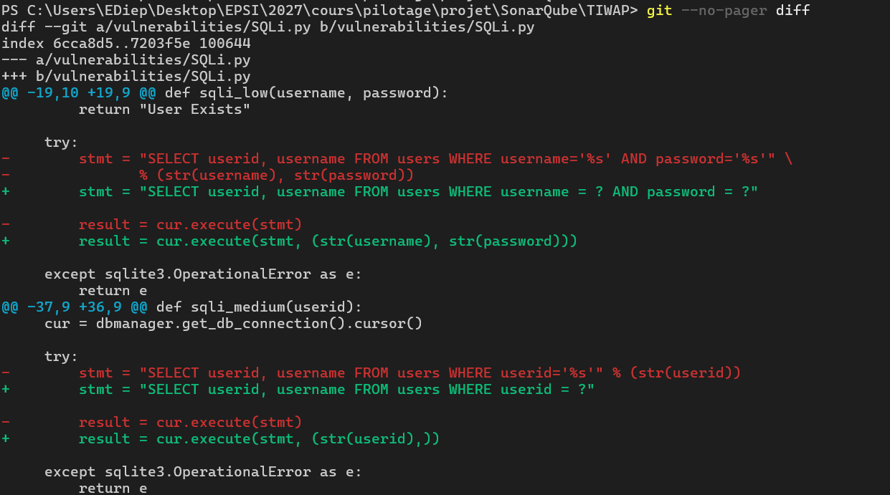

## 5. Tests

TIWAP ne contient aucun test. J'ai ajouté `TIWAP/tests/test_sqli.py` :

```python
def test_recherche_legitime_par_id():
    assert SQLi.sqli_medium("1") == [(1, "admin")]

def test_injection_userid_ne_retourne_rien():
    assert SQLi.sqli_medium("1' OR '1'='1") == []

def test_injection_login_ne_contourne_pas_le_mot_de_passe():
    assert SQLi.sqli_low("x' OR '1'='1' --", "a") == []
```

Le premier test vérifie que le fonctionnement normal est conservé, les deux autres que l'injection ne renvoie plus rien. Avant la correction, ces deux tests échouaient.

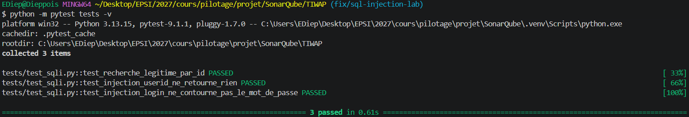

## 6. Comparaison avant / après

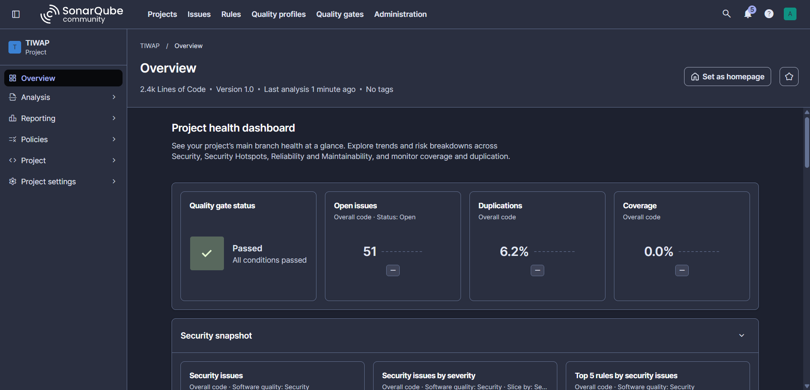
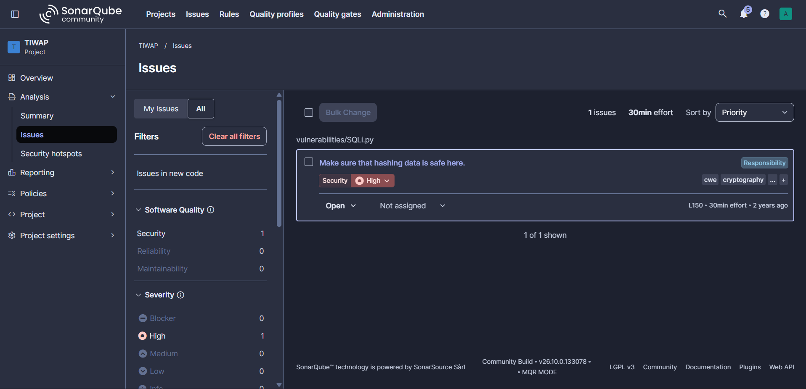

| Critère | Avant correction | Après correction |
|---|---|---|
| Anomalie étudiée | Injection SQL dans sqli_low et sqli_medium | Corrigée |
| Règle concernée | Aucune | Aucune |
| Emplacement | SQLi.py:22 et 40 | SQLi.py:22 et 39 |
| Code vulnérable présent ? | Oui | Non pour ces deux fonctions |
| Tests de régression | Aucun | 3 tests réussis |
| Risque résiduel | Élevé | Élevé : d'autres fonctions de SQLi.py restent vulnérables, ainsi que MD5, le JWT et la clé Flask |

Les chiffres de SonarQube n'ont pas changé (51 issues). C'est normal, puisque l'injection n'était pas détectée avant. La correction est donc prouvée par le diff et les tests. La Quality Gate est « Passed » malgré 2 Blockers, car elle ne contrôle que le nouveau code.

## 7. Fiche de traitement NOVA SERVICES

| Champ | Valeur |
|---|---|
| Application | Application web avec authentification |
| Anomalie | Injection SQL sur le formulaire de connexion |
| Priorité | Critique : exploitable sans compte, accès aux données clients |
| Responsable | Lead développeur, validation par l'équipe sécurité |
| Échéance | 7 jours |
| Statut | Corrigé sur la branche fix/sql-injection-lab, en attente de revue |
| Preuve | git diff, tests réussis, nouvelle analyse SonarQube |
| Risque résiduel | Élevé tant que les autres failles ne sont pas corrigées |

## 8. Indicateurs de suivi

| Indicateur | Définition | Source | Fréquence | Responsable | Décision |
|---|---|---|---|---|---|
| Vulnérabilités ouvertes | Nombre par priorité | SonarQube | Hebdomadaire | RSSI | Répartir l'effort de correction |
| Vulnérabilités en retard | Critiques ou élevées hors échéance | Outil de tickets | Hebdomadaire | RSSI | Escalader ou bloquer une mise en production |
| Délai médian de correction | Temps entre détection et correction | Outil de tickets | Mensuelle | Responsable développement | Ajuster les ressources |
| Corrections vérifiées | Part des corrections confirmées par une nouvelle analyse et un test | SonarQube et CI | Mensuelle | Équipe sécurité | Valider ou rouvrir une correction |

## 9. Questions de compréhension

1. PostgreSQL stocke les données de SonarQube (configuration, règles, historique). Elles sont ainsi conservées si le conteneur est recréé.
2. Dans un conteneur, `localhost` désigne le conteneur lui-même. Le scanner joint SonarQube par le nom du service sur le réseau Docker, alors que le navigateur passe par le port publié sur la machine.
3. L'analyse statique lit le code sans l'exécuter. Le test d'intrusion attaque l'application en fonctionnement et prouve qu'une faille est exploitable.
4. L'entrée devient une partie de la requête et peut en changer le sens.
5. La requête paramétrée sépare la requête des valeurs, qui ne sont jamais interprétées comme du SQL.
6. Une validation peut être contournée ou incomplète. Elle complète les requêtes paramétrées mais ne les remplace pas.
7. L'outil peut signaler un faux problème ou en rater un vrai, comme l'injection SQL ici. Il faut lire le code pour conclure.
8. Le noter dans le rapport, examiner le code à la main, vérifier les règles actives et compléter par des tests.
9. En tenant compte de la sensibilité des données, de l'exposition, de la facilité d'exploitation et de l'impact, pas seulement de la note de l'outil.
10. Il ne tient compte ni de la gravité ni de l'exposition, et il ignore les failles non détectées.
11. Jeton limité au projet, stocké dans une variable masquée, avec une date d'expiration, et jamais écrit dans le dépôt ou les journaux.
12. Avec le diff, un test de non-régression exécuté à chaque modification et une nouvelle analyse.

## 10. Conclusion

SonarQube a trouvé des failles réelles (clé Flask, JWT, MD5) mais n'a pas détecté l'injection SQL, pourtant la plus évidente du projet. Ses résultats dépendent de l'édition utilisée et des règles activées. Une analyse sans alerte ne prouve donc pas l'absence de faille : il faut la compléter par une revue du code et des tests.
